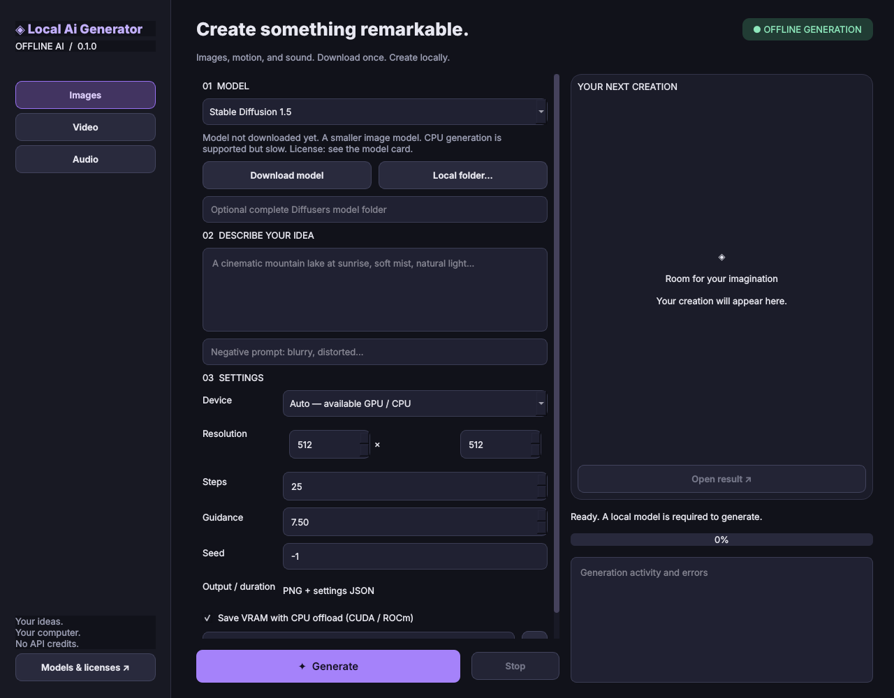

# Local Ai Generator

A Python desktop studio for **offline image, short video, and audio generation**. A dark interface with purple accents, isolated AI worker processes, and no paid generation APIs.

**Version 0.1.0 — initial development release.** The app, messages, installers, and documentation are currently English-only. Hardware support means an available backend and a CPU fallback; memory requirements and speed depend on your computer and model. Production quality and compatibility still need to be verified on target devices.



## Getting started

You need **64-bit Python 3.10–3.12** and a modern Windows, macOS, or Linux system. Internet access is required to install dependencies and download models initially. Model weights are not bundled.

### Windows

1. Download and extract the complete project. Enable **Add Python to PATH** when installing Python.
2. Run `Start.bat`. It creates a project `.venv`, installs the interface, and opens the app.
3. Run `Setup-AI-CPU.bat` for the portable CPU baseline. For an **NVIDIA** GPU, run `Setup-AI-GPU.bat` instead: it reads the installed driver (`nvidia-smi`), installs the matching PyTorch CUDA build (CUDA 12.6, 12.8 or 13.0) and replaces a CPU-only PyTorch already in the project environment. The standard PyPI build is CPU-only on Windows, so a plain `pip install torch` would silently not use the GPU. The installer prints a warning if PyTorch still cannot see the GPU (usually an outdated driver). AMD and Intel GPUs are not covered by this installer on Windows.
4. Open the app, select a model, review its model card and license, then select **Download model**.
5. When the download finishes, enter a prompt and select **Generate**. Generation now works offline.

### macOS

Run `python3 start.py` to open the interface. Run `python3 setup_ai.py --backend cpu` to install the AI engine; on macOS this uses the standard PyTorch build with MPS on supported Apple Silicon devices. You can also use `Start.command` and `Setup-AI.command` (run `chmod +x *.command` first if necessary). Intel Macs use CPU when a supported PyTorch build exists for the Python and OS combination.

### Linux

```bash
python3 start.py
python3 setup_ai.py --backend cpu
python3 start.py
```

Qt may require system X11/Wayland libraries. CPU is the default installation route. For an NVIDIA GPU run `python3 setup_ai.py --backend cuda` (the build is chosen from the installed driver; `--cuda-build cu126|cu128|cu130` overrides it). For AMD ROCm or Intel XPU, first install the appropriate PyTorch build using the [official installer](https://pytorch.org/get-started/locally/) **inside the project `.venv`**, then run:

```bash
python3 setup_ai.py --backend existing
```

The environment's Python executable is `.venv\Scripts\python.exe` on Windows and `.venv/bin/python` on macOS/Linux. Installing CPU or GPU dependencies can require several GB of disk space. Moving an entire `.venv` between operating systems is not supported.

## Features

- Images through SD 1.5, SDXL Base, and SDXL Turbo → PNG.
- Short text-to-video clips through LTX Video → MP4. Video generation does not create an audio track.
- Sounds and short musical textures through AudioLDM 2 → WAV, 16 kHz. This is not a full-song generator or a dedicated dubbing engine.
- Auto / CPU / CUDA or ROCm / Apple MPS / Intel XPU selection, depending on the installed PyTorch build.
- CUDA model CPU offload and VAE slicing/tiling where supported by the pipeline.
- Import of a complete local Diffusers folder matching the selected model architecture. Other architectures, GGUF, LoRA, and standalone checkpoint files are not supported in this version.
- Seed, negative prompt, inference steps, guidance, resolution, video frames/FPS, and audio duration controls.
- Progress reporting, error logs, worker process cancellation, and image previews.
- A unique directory and a settings JSON for each result. Existing outputs are not overwritten.

The app uses general workflow ideas familiar from MicrostockForge, such as Auto/GPU/CPU selection and local model loading. Its implementation is independent; no private MicrostockForge source code is included.

## App and repository names

The app is named **Local Ai Generator**, its Python package is `localaigenerator`, and its repository is `local-ai-generator`. If data from the earlier Local Ai Generator release already exists, the app reuses that directory and recognizes its download completion markers. Models do not need to be downloaded again. The legacy `LOCALAIGENERATOR_HOME` environment override is also supported.

## Models and hardware

| Model | Use | Practical expectations |
|---|---|---|
| SD 1.5 | Smaller image model, 512 px | Start here on less powerful computers. CPU generation is slow. |
| SDXL Base | Detailed images around 1024 px | Higher RAM/VRAM requirements; CUDA CPU offload may help. |
| SDXL Turbo | Fast previews | 1–4 steps, guidance 0, 512 px by default. |
| LTX Video | Short silent clips | A GPU is recommended; CPU generation can take a very long time. |
| AudioLDM 2 | Sounds / musical textures | 1–10 seconds; non-commercial model. |

Exact resource requirements are not guaranteed. They depend on the model, resolution, duration, weight precision, and OS. Computers with insufficient RAM can fail even in CPU mode. If memory runs out, reduce the resolution or frame count, close other applications, or choose a smaller model. MPS uses conservative float32 precision, which can require more memory. XPU and ROCm require compatible PyTorch builds and drivers; they have not been verified here.

Verified on Windows 11 with an NVIDIA RTX 4060 (8 GB VRAM) and a CUDA build of PyTorch: SD 1.5, SDXL Base, SDXL Turbo and AudioLDM 2 generate successfully. LTX Video is not verified on 8 GB VRAM; its text encoder alone needs about 9.5 GB. See `TEST_REPORT.md`.

LTX requires dimensions divisible by 32 and `8n+1` frames (for example, 25, 49, or 81). Approximate exported duration = frames / FPS. The default 25 frames at 24 FPS produces about 1.04 seconds. English prompts are recommended for both image and audio models; an offline translator is not included.

## Offline mode and model files

Before importing the AI libraries, the generation worker sets `HF_HUB_OFFLINE=1`, `TRANSFORMERS_OFFLINE=1`, disables Hugging Face telemetry, and loads models with `local_files_only=True`. Downloading is a separate explicit action. The app does not use remote generation APIs. You can disconnect the computer from the network after installation and model preparation.

Downloads are marked complete only after the downloader returns successfully. Interrupted downloads can be resumed by selecting **Download model** again. The downloader selects Diffusers components rather than every standalone checkpoint in a repository. Each component is finally validated when loading the pipeline. Hugging Face repositories may change; this version does not pin model weights to a specific revision.

Models and settings are stored outside the source project:

- Windows: `%LOCALAPPDATA%\LocalAiGenerator`
- macOS: `~/Library/Application Support/LocalAiGenerator`
- Linux: `~/.local/share/local-ai-generator` (respects `XDG_DATA_HOME`)
- Custom location: set `LOCALAIGENERATOR_HOME`.

Model weights are in the `models` subfolder, one folder per model (`sd15`, `sdxl`, `turbo`, `ltx`, `audioldm2`), for example `%LOCALAPPDATA%\LocalAiGenerator\models\sd15` on Windows. A model is ready when its folder contains the `.localaigenerator-complete` marker. Deleting a model folder frees its disk space; settings are in `settings.json` next to it.

For a computer without internet access, prepare the dependencies and model weights on a connected computer first. Transfer a complete model folder and select it in the app. Install dependencies on the target OS using matching pre-downloaded wheels. If a model requires authorization, use the Hugging Face CLI in the project environment (`hf auth login`) or import an authorized, previously downloaded model folder. The GUI does not provide its own sign-in screen.

Stopping a job terminates the worker process. An empty job folder or an incomplete `pending` file may remain; it is not reported as a completed result. Output JSON files contain prompts and local paths, so review them before sharing.

## Model and project licenses

A public repository does not automatically grant commercial-use rights for every model. Model weights are not redistributed, and their licenses are separate from the app's license.

- [SD 1.5](https://huggingface.co/stable-diffusion-v1-5/stable-diffusion-v1-5)
- [SDXL Base](https://huggingface.co/stabilityai/stable-diffusion-xl-base-1.0)
- [SDXL Turbo](https://huggingface.co/stabilityai/sdxl-turbo)
- [LTX Video](https://huggingface.co/Lightricks/LTX-Video)
- [AudioLDM 2](https://huggingface.co/cvssp/audioldm2): its model card specifies **CC-BY-NC-SA-4.0**, for non-commercial use.

The project license has not been selected yet; see `LICENSE-NOTICE.md`. Dependencies retain their own licenses. PySide6/Qt offers LGPL/GPL and commercial licensing; future binary distributions must preserve applicable license notices and requirements. This release distributes project source code, not a bundled Qt/PyTorch runtime or model weights.

## Development and testing

```bash
python -m unittest discover -s tests -v
python -m compileall -q localaigenerator start.py setup_ai.py
```

Core tests need no PyTorch, model weights, or network access. They cover validation, device selection, interrupted downloads, and export paths using substitutes for AI libraries. They do not demonstrate full-model quality or compatibility with every GPU. Optional GUI smoke test after installing the interface: `QT_QPA_PLATFORM=offscreen python tests/gui_smoke.py`.

GitHub Actions includes Windows/macOS/Linux and Python 3.10/3.12 test jobs. Check the repository's Actions tab for actual run results. Before a stable public release, full-model generation and installation on target operating systems still need verification. See `TEST_REPORT.md` for completed checks and limitations.

## GitHub repository

Development takes place in the private repository [jproucil-byte/local-ai-generator](https://github.com/jproucil-byte/local-ai-generator). The app name and repository name can differ.

```bash
git clone https://github.com/jproucil-byte/local-ai-generator.git
cd local-ai-generator
python start.py
```

Access to a private repository requires an authorized GitHub account. Repository visibility can be changed later in its settings. Model weights, `.venv`, personal settings, and generated outputs do not belong in Git.
